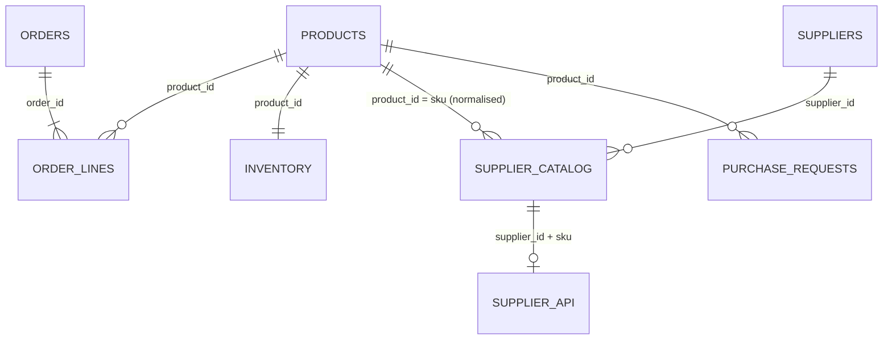

# BaanDee Restock Assistant

ต้นแบบระบบช่วยฝ่ายจัดซื้อ BaanDee Living ใช้หาสินค้าที่เสี่ยงขาดสต็อกและร่างคำขอสั่งซื้อ (purchase request) ทุกคำแนะนำแสดงหลักฐาน แหล่งที่มา และเวลาของข้อมูล ส่วนกรณีที่ข้อมูลไม่พอหรือขัดกัน ระบบจะหยุดและส่งให้ผู้ซื้อตัดสินใจเอง

> ข้อมูลทั้งหมดเป็นข้อมูลสังเคราะห์ ไม่มีข้อมูลบุคคลหรือบริษัทจริง ระบบไม่ส่งคำสั่งซื้อจริงถึง supplier

ส่วนที่มีป้าย `TODO` ทีมต้องเติมหรือยืนยันเอง

---

## 1. ปัญหา ผู้ใช้ และคุณค่าที่คาดหวัง

| คำถาม | คำตอบ |
|---|---|
| ผู้ใช้หลัก | **เจ้าหน้าที่จัดซื้อ (Buyer)** ที่ดูแลการเติมสินค้าเข้าคลัง BKK-DC |
| งานที่ทำ | ทุกเช้าต้องตัดสินใจว่า SKU ไหนต้องสั่งเพิ่ม สั่งกับ supplier รายไหน และสั่งเท่าไร |
| ปัญหาปัจจุบัน | ต้องเปิด 3 แหล่งแยกกัน คือ สต็อกคงเหลือ ประวัติยอดขาย และแคตตาล็อก supplier แต่ละแหล่งเขียนรหัส SKU ไม่เหมือนกัน หน่วยของ lead time ไม่ตรงกัน และอัปเดตไม่พร้อมกัน บาง SKU มี supplier 2 รายที่เงื่อนไขขัดกัน การคำนวณเองจึงช้าและผิดพลาดง่าย |
| ต้นแบบช่วยอย่างไร | รวมข้อมูลทั้ง 3 แหล่ง ตรวจ lead time ล่าสุดจาก Supplier API คำนวณว่าสต็อกเหลือพอขายกี่วันเทียบกับ lead time จัดระดับความเสี่ยง เสนอจำนวนที่ควรสั่ง และให้ผู้ซื้อ**สร้าง บันทึก เรียกกลับ และแก้ไข**คำขอสั่งซื้อได้ |
| สิ่งที่ยังเป็นสมมติฐาน | (1) ยอดขาย 30 วันล่าสุดใช้แทนความต้องการในอนาคตได้ (2) safety stock 7 วันเพียงพอ (3) ผู้ซื้อจะเชื่อและใช้คำแนะนำ (4) ระบบช่วยลดเวลาทำงาน — ทั้งหมด**ยังไม่ได้ทดลองกับผู้ใช้จริง** |

**ขอบเขต:** ระบบไม่ส่งคำสั่งซื้อจริง ไม่อนุมัติงบประมาณ และไม่แก้ตัวเลขสต็อก ผู้ซื้อเป็นคนตัดสินใจทุกครั้ง

## 2. แหล่งข้อมูล (Data map)

| แหล่ง | ไฟล์ / ระบบ | บทบาท | ที่มา |
|---|---|---|---|
| Products | `data/raw/products.csv` | ชื่อ หมวด ราคาขาย | ชุดข้อมูล BaanDee (ต้นฉบับ) |
| Inventory | `data/raw/inventory_snapshot.csv` | สต็อก ณ เวลา `as_of` | ชุดข้อมูล BaanDee (ต้นฉบับ) |
| Orders | `data/raw/orders.csv`, `order_lines.csv` | ยอดขาย → demand | ชุดข้อมูล BaanDee (ต้นฉบับ) |
| **Supplier catalog** | `data/generated/supplier_catalog.csv` | supplier, lead time, MOQ, pack size, ต้นทุน | **ข้อมูล generated** (สังเคราะห์) |
| **Suppliers** | `data/generated/suppliers.csv` | สถานะ supplier (active / on_hold) | **ข้อมูล generated** (สังเคราะห์) |
| **Supplier API** | `api/main.py` + `api/fixtures/supplier_live.json` | lead time / MOQ / สถานะล่าสุด | **ข้อมูล generated** (mock API) |
| **Purchase requests** | `data/app.db` (SQLite) | คำขอที่ผู้ใช้สร้างและแก้ไข + audit log | สร้างระหว่างใช้งาน |



**ข้อมูลที่ทีมสร้างขึ้นและวิธีสร้าง:** `scripts/generate_supplier_data.py` (seed คงที่ รันซ้ำได้ผลเดิม) ใช้รายการ SKU จาก `products.csv` และตั้ง supplier สมมติ 6 ราย ตัวเลขสุ่มในช่วงที่กำหนดดังนี้

**สมมติฐาน:**
- supplier 1 รายต่อหมวดสินค้า
- lead time 5–21 วัน
- MOQ 6–24 ชิ้น
- ต้นทุน 45–65% ของราคาขาย

ตัวเลขเหล่านี้**ไม่ได้อ้างอิงตลาดจริง** ปัญหาคุณภาพข้อมูลทุกจุดใส่เข้าไปโดยตั้งใจ และบันทึกไว้ใน [`data/generated/INJECTED_ISSUES.md`](data/generated/INJECTED_ISSUES.md)

## 3. ปัญหาคุณภาพข้อมูล

หลักฐานฉบับเต็ม ได้แก่ before/after, correction log และ quarantine อยู่ใน [`docs/DATA_QUALITY.md`](docs/DATA_QUALITY.md) ซึ่งสร้างจาก `python scripts/clean_data.py`

| # | ปัญหา | วิธีตรวจพบ | กฎ | ก่อน → หลัง |
|---|---|---|---|---|
| 1 | SKU เขียนไม่ตรงรูปแบบ (`sku-0012`, `SKU0027`, `SKU-61`) | join กับ products | normalise เฉพาะเมื่อผลลัพธ์มีอยู่จริงใน products | ไม่มี supplier **6 → 1** SKU, แถวที่ไม่มีสินค้านี้อยู่จริง 1 แถว → quarantine |
| 2 | lead time หลายหน่วย / `1-2 weeks` / `TBC` / ว่าง | integer parse | แปลงเฉพาะหน่วยที่ชัด ส่วนที่เหลือไม่เดา | ใช้ได้ **78 → 81/84**, 3 แถวส่งให้คน |
| 3 | SKU เดียวมี 2 supplier เงื่อนไขต่างกัน | `duplicated(product_id)` | ไม่เลือกให้อัตโนมัติ | 3 SKU → HUMAN_REVIEW |
| 4 | วันที่ order ไม่ใช่ ISO (`28/07/2026`, `07/08/2026`) | ISO check + day > 12 test | แปลงเมื่ออ่านได้แบบเดียว ถ้าอ่านได้สองแบบให้ quarantine | 1 แก้, 1 ไม่นับใน demand |
| 5 | หมวดสินค้าเขียนต่างกัน (`Bed room`, `kitchen`) | `value_counts()` | category map | **8 → 4** หมวด |
| 6 | ค่าที่เป็นไปไม่ได้ (MOQ ≤ 0, ต้นทุน > ราคาขาย) | range check | flag ไม่แก้เอง | 3 แถว flagged |
| 7 | แคตตาล็อกเก่า (SUP-06 อัปเดต มี.ค.) | timestamp > 90 วัน | แสดงคำเตือน ค่าจาก API มาก่อน | 2 แถว flagged |

`data/raw/` ไม่ถูกแก้ ตรวจได้ด้วย test T12 (เทียบ `data/raw_checksums.sha256`)

## 4. กฎการตัดสินใจ (`src/restock.py`)

- `avg_daily_demand` = ยอดขาย 30 วันก่อน `as_of` ของ inventory ÷ 30 (ไม่นับ order ที่วันที่กำกวม)
- `days_of_cover` = สต็อก ÷ avg_daily_demand
- ความเสี่ยง:
  - **HIGH** เมื่อ days_of_cover < lead time
  - **MEDIUM** เมื่อ days_of_cover < lead time + 7 วัน
  - **OK** ในกรณีอื่น
- `suggested_qty` = demand × (lead time + 30 + 7) − สต็อก แล้วปรับให้ไม่ต่ำกว่า MOQ และปัดขึ้นเป็นทวีคูณ pack size
- **HUMAN_REVIEW (ระบบหยุด)** เมื่อ:
  - ไม่มี supplier
  - มี supplier หลายราย
  - lead time ไม่ชัดและ API ไม่ยืนยัน
  - supplier ถูกระงับ (on hold)
  - MOQ ไม่ถูกต้อง
  - ต้นทุนสูงกว่าราคาขาย
- **ข้อมูลสดกับข้อมูลเก่าขัดกัน:** ค่าจาก Supplier API ชนะค่าจากแคตตาล็อก และระบบแสดงทั้งสองค่าพร้อมเวลาของข้อมูล
- **Guardrail ฝั่งผู้ใช้:**
  - ถ้าแก้จำนวนให้ต่างจากที่ระบบแนะนำ ต้องใส่เหตุผล
  - ถ้าจะสร้างคำขอสำหรับเคส HUMAN_REVIEW ต้องเลือก supplier และใส่เหตุผลเอง

**เหตุผลของตัวเลขที่เลือก** (ค่าตั้งต้นของต้นแบบ ปรับได้ใน `src/restock.py` และ `src/data_prep.py`)

| ค่า | ใช้ทำอะไร | เหตุผล | ข้อจำกัด |
|---|---|---|---|
| **30 วัน** (`DEMAND_WINDOW_DAYS`) | ช่วงยอดขายที่ใช้คำนวณ demand | ข้อมูลล่าสุดสะท้อนความต้องการปัจจุบันได้ดีกว่ายอดเฉลี่ยทั้ง 3 เดือน และยังมี order มากพอให้ค่าเฉลี่ยไม่แกว่งเกินไป | ถ้าเดือนล่าสุดมีโปรโมชัน demand จะสูงเกินจริง |
| **7 วัน** (`SAFETY_DAYS`) | safety stock และเส้นแบ่งความเสี่ยง MEDIUM | เผื่อกรณี supplier ส่งช้าหรือยอดขายพุ่งประมาณ 1 สัปดาห์ เช่น SKU-0001 ที่ lead time เพิ่มจาก 7 เป็น 13 วันจากประกาศของ supplier | เป็นค่าคงที่เท่ากันทุกสินค้า ยังไม่ได้คิดจากความแปรปรวนของยอดขายจริง |
| **30 วัน** (`COVER_TARGET_DAYS`) | สั่งให้พอขายอีกกี่วันหลังของมาถึง | สั่งประมาณเดือนละครั้งต่อ SKU เพื่อไม่ให้ต้องสั่งถี่ และไม่ให้ของค้างสต็อกนานเกินไป | ยังไม่ได้คิดค่าจัดเก็บหรือค่าขนส่งต่อครั้ง |
| **90 วัน** (`STALE_CATALOG_DAYS`) | แคตตาล็อกเก่ากว่านี้ถือว่า stale | supplier ควรทบทวนราคาและเงื่อนไขอย่างน้อยทุกไตรมาส | เป็นสมมติฐานของทีม ยังไม่ได้ยืนยันกับฝ่ายจัดซื้อจริง |

ตัวเลขทั้งหมดนี้เป็นสมมติฐานที่ต้องปรับเมื่อได้คุยกับผู้ใช้จริง (ดูหัวข้อ 1 ข้อ 5)

## 5. Architecture และการเชื่อมระบบ

```
data/raw + data/generated ──► src/data_prep.py ──► data/cleaned/ (clean, quarantine, correction_log, dq_report)
                                                          │
Supplier API (api/main.py, :8001) ◄── HTTP GET ── src/supplier_client.py
   200 ok / 404 not_found / 503 + timeout → unavailable   │
                                                          ▼
                                     src/restock.py (กฎ, risk, HUMAN_REVIEW)
                                                          │
                       src/app.py (Gradio :7860) ◄──► src/store.py (SQLite data/app.db + audit_log)
```

**จุดเชื่อมระบบ:** `src/supplier_client.py` ส่ง `GET /suppliers/{supplier_id}/skus/{sku}` แล้วตรวจ status code และฟิลด์ที่จำเป็นก่อนนำค่าไปใช้

| ผลที่ได้ | ผลต่อระบบ |
|---|---|
| **ok** | lead time และ MOQ จาก API ถูกนับเป็นข้อเท็จจริงที่ยืนยันแล้ว |
| **not_found** | ใช้ค่าจากแคตตาล็อกถ้ามี ถ้าไม่มีให้ HUMAN_REVIEW |
| **unavailable** (503, timeout หรือเชื่อมต่อไม่ได้) | ใช้ค่าจากแคตตาล็อก ติดป้ายว่า "ยังไม่ยืนยันจาก supplier" และไม่ใส่ลงช่องข้อเท็จจริง |

**เหตุผลที่เลือกเครื่องมือ:**
- pandas, FastAPI, Gradio และ pytest เป็น stack เดียวกับที่ใช้ในคาบ ทีมจึงอธิบายได้ และรันบนเครื่องได้โดยไม่ต้องใช้ cloud
- SQLite ไม่ต้องติดตั้งเพิ่ม และข้อมูลที่บันทึกยังอยู่หลังปิดโปรแกรม
- การลบใช้ soft delete และทุกการแก้ไขถูกบันทึกลง `audit_log`

## 6. AI ในผลิตภัณฑ์

**ไม่ใช้ AI ในการตัดสินใจ** เพราะ:
- จุดสั่งซื้อและจำนวนที่ควรสั่งเป็นสูตรที่ตรวจสอบย้อนหลังได้ทุกขั้นตอน
- ถ้าให้โมเดลสร้างตัวเลข lead time หรือจำนวนสั่ง จะเสี่ยงต่อการเดาค่าที่ไม่มีหลักฐาน ซึ่งเป็นสิ่งที่ผลิตภัณฑ์นี้ต้องป้องกัน
- ส่วนที่ต้องใช้วิจารณญาณ (supplier ซ้ำ หรือข้อมูลขัดกัน) ส่งให้คนตัดสินใจอยู่แล้ว

ดูการใช้ AI ช่วยพัฒนาได้ใน [`AI_USE.md`](AI_USE.md)

## 7. ติดตั้งและรัน

ใช้ Python 3.11 ขึ้นไป

```bash
python -m venv .venv
# Windows: .venv\Scripts\activate     Mac/Linux: source .venv/bin/activate
pip install -r requirements.txt
python scripts/generate_supplier_data.py   # (ไม่บังคับ) สร้างข้อมูล supplier ใหม่ ผลเหมือนเดิมทุกครั้ง
python scripts/clean_data.py               # สร้าง data/cleaned/ และ docs/DATA_QUALITY.md
```

เปิด 2 หน้าต่าง Terminal:

| | Windows | Mac / Linux |
|---|---|---|
| Terminal 1: Supplier API | `scripts\start_api.bat` | `./scripts/start_api.sh` |
| Terminal 2: แอป | `scripts\start_app.bat` | `./scripts/start_app.sh` |

เปิดแอปที่ http://127.0.0.1:7860 ส่วนเอกสาร API อยู่ที่ http://127.0.0.1:8001/docs

**Tests:** `python -m pytest -q` หรือ `python scripts/run_test_report.py` เพื่อสร้าง [`tests/TEST_RESULTS.md`](tests/TEST_RESULTS.md) (มี input / expected / actual / pass-fail)

**ค่า environment** (ไม่ตั้งก็ใช้ค่า default ได้ ดู `.env.example`):
- `SUPPLIER_API_URL`
- `SUPPLIER_API_TIMEOUT_SECONDS`
- `DB_PATH`

## 8. กรณีสาธิต

| # | ขั้นตอน | ผลที่คาดหวัง |
|---|---|---|
| 1 | แท็บ 1 → คำนวณภาพรวม | แนะนำให้สั่ง 13, ส่งให้คนตรวจ 7, ปกติ 62 SKU |
| 2 | แท็บ 2 → `SKU-0001` → ตรวจสอบ | **RECOMMEND / HIGH**: แคตตาล็อกบอก lead time 7 วัน แต่ Supplier API ส่งประกาศล่าช้ามา ทำให้เป็น 13 วัน (เหลือพอขาย 8.3 วัน) แนะนำ 30 ชิ้น |
| 3 | แก้จำนวนเป็น 40 → บันทึก | ❌ ถูกปฏิเสธเพราะไม่มีเหตุผล → ใส่เหตุผลแล้วบันทึกได้ ✅ |
| 4 | แท็บ 3 → เรียกคำขอ #1 → แก้จำนวนและสถานะ → บันทึก | ข้อมูลเปลี่ยนจริง และ audit log แสดงค่าเก่ากับค่าใหม่ |
| 5 | แท็บ 2 → `SKU-KT-104` | **HUMAN_REVIEW**: มี supplier 2 ราย (รายหนึ่งถูกระงับ) ระบบไม่เลือกให้ |
| 6 | แท็บ 2 → `SKU-0048` | **HUMAN_REVIEW**: สต็อก 0 และไม่มี supplier |
| 7 | ติ๊ก "จำลอง Supplier API ล่ม" → `SKU-0001` | ใช้ lead time 7 วันจากแคตตาล็อก ความเสี่ยงลดเป็น MEDIUM และมีคำเตือนว่ายังไม่ยืนยันจาก supplier |

## 9. Tests

ผ่าน 12/12 รายละเอียดอยู่ใน [`tests/TEST_RESULTS.md`](tests/TEST_RESULTS.md)

| กลุ่ม | กรณีที่ทดสอบ |
|---|---|
| Cleaning | T01–T03: SKU, lead time, วันที่กำกวม |
| การส่งต่อให้คน | T04–T05: supplier ซ้ำ, ไม่มี supplier |
| API | T06–T08: success, not found, unavailable |
| การคำนวณ | T09: จำนวนสั่งไม่ต่ำกว่า MOQ และเป็นทวีคูณ pack size |
| ฐานข้อมูล | T10–T11: บันทึก, เรียกกลับ, แก้ไข, audit, soft delete |
| ข้อมูลดิบ | T12: data/raw ไม่ถูกแก้ |

## 10. ข้อจำกัดและสิ่งที่ยังไม่ควรนำไปใช้จริง

- demand มาจากยอดขาย 3 เดือน และ inventory มี snapshot เดียว ยังไม่รวมฤดูกาล โปรโมชัน หรือสินค้าที่กำลังขนส่งเข้ามา
- มีคลังเดียว (BKK-DC) ข้อมูล supplier และ API เป็นข้อมูลจำลอง
- ไม่มีระบบ login หรือสิทธิ์ผู้ใช้ ใครเปิดแอปได้ก็แก้คำขอได้
- ประกาศจาก supplier ใน fixture ยังเป็นภาษาอังกฤษ (จำลองข้อความที่ supplier ส่งมาเอง)

## 11. บทบาทสมาชิก

| สมาชิก | รับผิดชอบ | รับผิดชอบ |
|---|---|---|
| กัญธิดา ผาสุข | 67011216010 | ข้อมูล, cleaning, หลักฐานคุณภาพข้อมูล |
| TODO | 670112160 | Supplier API และ client |
| TODO | 670112160 | กฎการตัดสินใจ และ SQLite |
| TODO | 670112160 | หน้าจอ, tests, README และการสาธิต |
